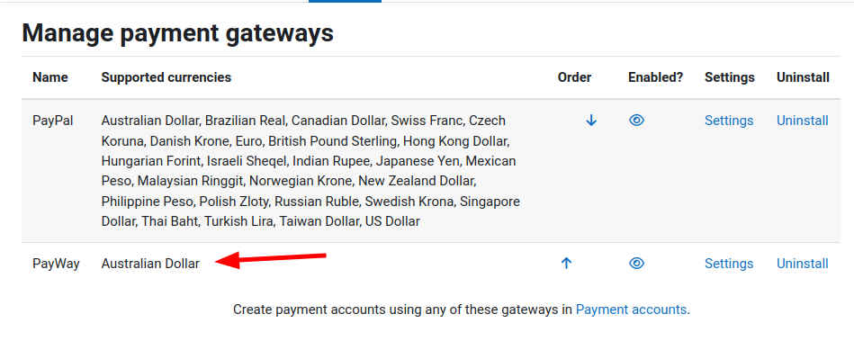
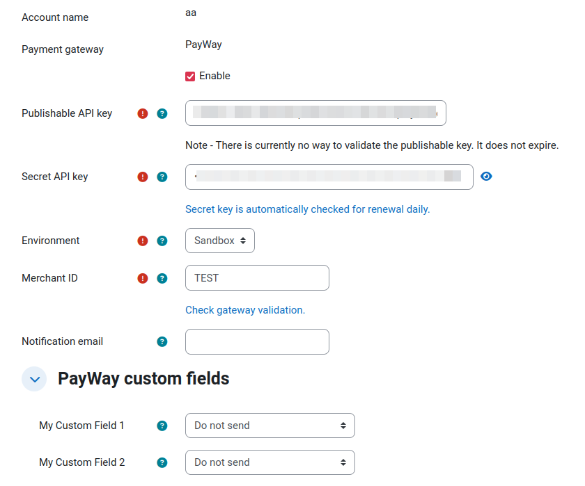

**This plugin is currently under construction!**
---

# moodle-paygw_payway
Moodle payment gateway plugin for [Westpac PayWay](https://www.payway.com.au)

# Feature support
## Supported
- Credit/Debit card payments
- Automated token renewal
- Transaction custom fields

## Not Supported
- 3DSecure
- Refunds
- Bank account payments

# Branches

| Branch              | Moodle Version |
|---------------------|----------------|
| `MOODLE_405_STABLE` | Moodle 4.5+    |

# Configuration

Once installed, the plugin will appear as a Payment gateway in Moodle:



Then payment accounts can be configured with PayWay as a gateway:



Each configuration option has relevant help text that explains what the purpose is any useful setup information.

Custom fields must be configured in the PayWay interface first, and then the plugin will automatically detect them and allow you to link them to corresponding Moodle fields.

Once configured and enabled, the account can be used anywhere Payment gateways/accounts are integrated into, for example `enrol_fee`.

## Security considerations
The payment form loads `payway.js` from PayWay's official HTTPS endpoint. PayWay's [documentation](https://www.payway.com.au/docs/rest.html#paywayjs) explicitly says not to host this library locally, and its [API versioning policy](https://www.payway.com.au/docs/rest.html#versioning-and-base-url) allows backward-compatible changes to the script without a major version change. A fixed Subresource Integrity hash would therefore become stale and could prevent payments from loading. The plugin uses the fixed PayWay origin and accepts the provider-managed script updates; administrators should review PayWay integration/security notices as part of routine maintenance.

## Important
This plugin processes credit/debit card payments in conjunction with Westpac PayWay. It is important to note what this plugin will do when certain statuses are returned. [See the full list of statuses in the PayWay API Documentation](https://www.payway.com.au/docs/rest.html#transaction-status).

While most credit/debit card payments will return either `approved` or `declined`, it is technically possible to return other statuses. Most of these statuses usually occur when processing bank account payments (which are not supported), however, in the case of any of these statuses are encountered, the plugin will handle them as follows:

| Status      | Explanation                                                                    | Will the order be delivered    | Will a follow up notification be sent |
|-------------|--------------------------------------------------------------------------------|--------------------------------|---------------------------------------|
| `approved`  | A successful transaction.                                                      | Yes                            | No                                    |
| `approved*` | A successful transaction during period when it may be declined or dishonoured. | Yes                            | Yes                                   |
| `pending`   | Currently processing.                                                          | Yes                            | Yes                                   |
| `declined`  | An unsuccessful transaction.                                                   | No                             | No                                    |
| `voided`    | Originally approved, but then cancelled prior to settlement.                   | No                             | Yes                                   |
| `suspended` | An unusual payment for you to review.                                          | No                             | Yes                                   |

Unusual statuses will notify the configured gateway's `notificationemail` email for manual review. **This plugin only checks the status at the moment of payment** - meaning asynchronous statuses such as `approved*` and `pending` are not able to be automatically handled - this is a limitation of the Moodle payment gateway API. The intention is that you will manually reconcile these after receiving a notification from the plugin.

## Events
The `\paygw_payway\event\payway_payment` event is triggered for every valid transaction response returned by PayWay, including declined and unusual statuses. Its `other` data includes the PayWay `status`, transaction and receipt identifiers, and the Moodle component, payment area, and item ID.

# Testing
This plugin is covered by both phpunit and behat tests.

Note, there are some Behat tests that only run if you give it a real PayWay sandbox API token:

```
PAYGW_PAYWAY_TEST_PUBLISHABLE_KEY=xxxx \
PAYGW_PAYWAY_TEST_SECRET_KEY=yyyy \
php admin/tool/behat/cli/run.php --tags="@paygw_payway" --profile=chrome
```

# Support

If you have issues please log them in GitHub.

Please note our time is limited, so if you need urgent support or want to sponsor a new feature then please contact [Catalyst IT Australia](https://www.catalyst-au.net/contact-us).

